# Async Order Processing System

## Overview

This project implements an e-commerce order processing system using C# and .NET 10. It demonstrates asynchronous programming, thread safety, concurrent processing, cancellation, fault handling, and JSON file-based storage.

The application simulates database and external service operations using delays instead of connecting to a real database or external API. Orders are validated, priced, processed, paid for, saved, and confirmed by email.

The project is divided into four phases:

- **Phase 1:** Asynchronous data access and order validation.
- **Phase 2:** Concurrent order processing, pricing, stock reservation, invoice generation, and reporting.
- **Phase 3:** Full checkout workflow, payment failures, refunds, email retries, and sync-versus-async comparison.
- **Phase 4:** Advanced asynchronous workflows, including live checkout, dashboard queries, shipping quotes, fraud scoring, and email re-sending.

## Requirements

- .NET 10 SDK
- C# and the .NET CLI
- Visual Studio or Visual Studio Code

The project targets `net10.0`.

## How to Run

Open a terminal in the `OrderProcessing` project directory, where `OrderProcessing.csproj` is located.

Run each phase independently:

```powershell
dotnet run -- phase1
dotnet run -- phase2
dotnet run -- phase3
dotnet run -- phase4
```

The Phase 3 comparison mode can be run separately:

```powershell
dotnet run -- compare
```

To test cancellation, pass `--cancel-after` followed by a duration in milliseconds:

```powershell
dotnet run -- phase4 --cancel-after 1000
```

The assignment also specifies an `all` mode and a numbered menu when no arguments are supplied. Ensure the current `Program.cs` dispatches those options to the intended phases before relying on them.

### Data Directory

The application stores its runtime data under:

```text
bin/Debug/net10.0/Data/
```

The directory is resolved relative to `AppContext.BaseDirectory`. The exact output directory can vary with the selected build configuration.

Each phase resets its runtime data before processing so that results from previous runs do not unintentionally affect the next phase.

## Project Structure

```text
OrderProcessing/
├── Program.cs
├── OrderProcessing.csproj
├── Shared/
│   ├── Models/
│   ├── Storage/
│   ├── Logging/
│   └── Exceptions/
├── Phase1/
├── Phase2/
├── Phase3/
├── Phase4/
├── bin/
│   └── Debug/
│       └── net10.0/
│           └── Data/
└── README.md
```

### Main Components and Responsibilities

| Component | Responsibility |
|---|---|
| `Program.cs` | Application entry point, dependency construction, command-line arguments, and execution-mode selection. |
| `OrderProcessing.csproj` | Project configuration and target framework. |
| `Shared/Models/` | Domain models such as `Customer`, `Product`, `Order`, `OrderItem`, `Coupon`, `PaymentTransaction`, `PaymentResult`, `EmailMessage`, and `Report`. |
| `Shared/Storage/` | JSON storage utilities, file-name constants, and data seeding. |
| `JsonFileStore` | Shared JSON file access abstraction used by repositories and services. |
| `DataFiles` | Centralized names for JSON files and related output directories. |
| `DataSeeder` | Resets runtime data and recreates the seed files at the start of a phase. |
| `Shared/Logging/` | Console logging helpers used by the processing workflows. |
| `Shared/Exceptions/` | Custom exceptions for domain, storage, payment, shipping, and email failures. |
| `Phase1/` | Repositories and validation logic, including the synchronous-versus-asynchronous validation comparison. |
| `Phase2/` | Pricing, concurrent order processing, race-condition demonstrations, invoice generation, and report generation. |
| `Phase3/` | Full checkout processing, inventory management, payment handling, refund handling, email retries, and sync-versus-async comparison. |
| `Phase4/` | Advanced workflows for live checkout, dashboard aggregation, shipping quotes, fraud scoring, email re-sending, and cancellation. |

### Design Principles

- Each class has a focused responsibility.
- Repositories access JSON data through the shared storage abstraction.
- External payment and email services are represented by interfaces such as `IPaymentGateway` and `IEmailService`.
- Dependencies are supplied through constructors rather than a dependency injection container.
- Asynchronous methods use `async` and `await` where appropriate.
- Cancellation tokens are propagated through asynchronous workflows.
- `Stopwatch` is used to measure execution time.

## Storage Design

### JSON Files

Each collection is stored as a JSON array.

| File or Directory | Purpose |
|---|---|
| `customers.json` | Seed customer records; read-only during a run. |
| `products.json` | Product details and stock quantities, which change during stock reservation and release. |
| `coupons.json` | Seed coupon records; read-only during a run. |
| `incoming_orders.json` | The 20 sample orders used as input for processing. |
| `orders.json` | Processed orders, including status, price fields, and failure reasons. |
| `payments.json` | Payment transaction records, including captured, declined, and refunded payments. |
| `emails.json` | Email messages stored in the outbox. |
| `email_retry.json` | Email messages that failed all retry attempts in Phase 3. |
| `invoices/` | Invoice text files generated in Phase 2, named `invoice_{orderId}.txt`. |
| `reports/` | JSON reports generated in Phase 2, named `report_{yyyyMMdd_HHmmss}.json`. |

### Serialization Rules

The storage design uses `System.Text.Json` with the following conventions:

- Indented JSON output using `WriteIndented = true`.
- Camel-case property names using `JsonNamingPolicy.CamelCase`.
- Enum values serialized as strings through `JsonStringEnumConverter`.
- UTF-8 file encoding.
- Empty collections represented as `[]`, not empty files.
- Money values represented using `decimal`.

A missing collection file should return an empty collection, while invalid JSON should be reported through `DataFileCorruptedException` with the affected filename included in the message.

### Concurrent Access and Data Consistency

Concurrent processing can cause lost updates when multiple operations read a shared file, modify the contents, and write the result back independently.

The repository implementation uses `SemaphoreSlim` to coordinate critical operations such as stock reservation, stock release, and order saving.

For example, the safe stock reservation sequence is:

1. Acquire the synchronization lock.
2. Read the current product stock.
3. Verify that the requested quantity is available.
4. Update the stock quantity.
5. Write the updated product collection.
6. Release the lock in a `finally` block.

This prevents concurrent reservations from using the same stale stock value in the protected reservation path.

Order saves are also coordinated to reduce the risk of one update overwriting another update to `orders.json`.

The shared JSON storage layer centralizes collection access. Crash-safe writes should also use a safe replacement strategy so that an interrupted write cannot leave a partially written JSON file.

## Performance Results

These tables summarize the measurements recorded during the observed runs. Execution times and thread counts can vary with system load and runtime scheduling.

### Phase 1 — Synchronous vs. Asynchronous Validation

| Metric | Synchronous | Asynchronous |
|---|---:|---:|
| Total orders | 20 | 20 |
| Validated orders | 15 | 15 |
| Rejected orders | 5 | 5 |
| Processing time | 34.3 s | 35.4 s |
| Distinct threads | Not measured | Not measured |
| `ThreadPool.ThreadCount` | Not measured | Not measured |

Rejected orders:

- Order #4 — Customer is inactive.
- Order #9 — Insufficient stock for `Wireless Mouse`.
- Order #12 — Coupon `OLD20` has expired.
- Order #15 — Customer #99 not found.
- Order #18 — Coupon `FAKE50` does not exist.

The final `orders.json` contains 20 records.

### Phase 2 — Pricing Comparison

| Metric | Sequential | Concurrent |
|---|---:|---:|
| Pricing time | 3.19 s | 2.34 s |
| Distinct threads | Not measured | Not measured |
| `ThreadPool.ThreadCount` | Not measured | Not measured |

The concurrent pricing implementation starts independent discount and shipping calculations together rather than waiting for each calculation to finish before starting the next.

#### Pricing Rules

- `UnitPrice` is obtained from the product data.
- `SubTotal` is the sum of each item's unit price multiplied by its quantity.
- The loyalty discount is 0% for Bronze, 5% for Silver, and 10% for Gold.
- The coupon discount is added to the loyalty discount, capped at 30%.
- Shipping is calculated as `5.00 + 1.50 × total quantity + 2.00 × total weight in kg`, unless the subtotal is at least `1000.00`, in which case shipping is free.
- `TotalAmount = SubTotal - Discount + ShippingCost`.
- Monetary values are rounded to two decimal places using `MidpointRounding.AwayFromZero`.

Expected pricing examples:

| Order | Subtotal | Discount | Shipping | Total |
|---|---:|---:|---:|---:|
| #1 | 1225.00 | 245.00 | 0.00 | 980.00 |
| #2 | 800.00 | 40.00 | 7.30 | 767.30 |

### Phase 2 — Concurrent Order Processing

| Metric | Recorded result |
|---|---:|
| Concurrent order-processing time | 19.74 s |
| `ThreadPool.ThreadCount` | 3 → 5 |
| Distinct threads | Not measured |

The recorded processing result was:

| Status | Count |
|---|---:|
| Completed | 13 |
| Rejected | 6 |
| Failed | 1 |
| Total orders | 20 |

The failed order was Order #7, due to `Shipping provider unavailable`. The application released stock reserved by the failed workflow, saved the failure, and continued processing the remaining orders.

The report from a recorded run showed:

- Total revenue: `5970.95`
- Average order value: `459.30`
- Top-selling product: `USB-C Hub`
- Top-selling quantity: `5`

### Phase 3 — Sync vs. Async Comparison

This comparison used 10 orders in each version with failure scenarios disabled.

| Metric | Synchronous | Asynchronous |
|---|---:|---:|
| Orders processed | 10 | 10 |
| Processing time | 13.09 s | 13.65 s |
| Distinct threads observed | 10 | 3 |
| `ThreadPool.ThreadCount` | 3 → 3 | 3 → 8 |
| Completed orders | 8 | 8 |
| Rejected orders | 2 | 2 |

The rejected orders were #4 and #9. The asynchronous version did not finish faster in this particular run, but async I/O can scale better because threads are not kept blocked while waiting for I/O completion.

### Phase 3 — Full Checkout Workflow

| Metric | Recorded result |
|---|---:|
| Orders selected | 20 |
| Tasks started | 20 |
| Tasks finished | 20 |
| Tasks cancelled | 0 |
| Processing time | 26.95 s |
| Distinct threads observed | 6 |
| `ThreadPool.ThreadCount` | 4 → 5 |

Final order statuses:

| Status | Count |
|---|---:|
| Completed | 11 |
| Rejected | 6 |
| PaymentFailed | 2 |
| Failed | 1 |
| Total | 20 |

Important scenarios observed:

- Order #5 — Payment gateway timeout.
- Order #8 — Card declined by issuer.
- Order #13 — Database save failed after payment, and the captured payment was refunded.
- Order #3 — Email delivery succeeded after retries.
- Order #17 — All four email attempts failed, so the message was queued for later retry.

In the recorded run, Order #5 reported a payment timeout of approximately 3 seconds.

### Phase 4 — Advanced Async Workflows

#### Task 10.1 — Live Checkout

| Metric | Recorded result |
|---|---:|
| Orders processed | 20 |
| Processing time | 26.90 s |
| Completed | 11 |
| Rejected | 6 |
| PaymentFailed | 2 |
| Failed | 1 |

#### Task 10.2 — Dashboard

| Query | Elapsed time | Distinct threads observed | `ThreadPool.ThreadCount` |
|---|---:|---:|---|
| Customer #3 | 799 ms outer-call elapsed | 3 | 5 → 5 |
| Customer #99 | 803 ms | 3 | 5 → 5 |

The Customer #3 query returned the customer's order and payment information. The Customer #99 test reported that the customer was not found and that the payments store timed out.

#### Task 10.3 — Shipping Quotes

| Metric | Recorded result |
|---|---:|
| Total time for the recorded run | 4.87 s |
| Distinct threads observed | 4 |
| `ThreadPool.ThreadCount` | 5 → 5 |

The service requests quotes from multiple carriers concurrently, chooses a successful quote when one becomes available, and cancels outstanding carrier requests. A flat-rate fallback is used when no successful quote arrives within the configured time budget.

A separate failure test is intended to demonstrate the `All carriers failed` outcome for Order #6.

#### Task 10.4 A — Fraud Scoring

| Metric | Sequential | Parallel |
|---|---:|---:|
| Processing time | 4.21 s | 0.67 s |
| Flagged orders | 1005 | 1005 |
| Distinct threads observed | 1 | 12 |
| `ThreadPool.ThreadCount` | Not separately recorded | 5 → 13 |

The sequential and parallel results matched, and the requirements check passed.

- First flagged IDs: `4, 8, 12, 29, 33`
- Reported speedup: approximately **6.28×**
- Processor count: 12

#### Task 10.4 B — Email Re-send

| Metric | Recorded result |
|---|---:|
| Emails sent | 30 |
| Emails stored in `emails.json` | 30 |
| Each email stored exactly once | Yes |
| Highest concurrent sends | 4 |
| Processing time | 8.09 s |
| Distinct threads observed | 4 |
| `ThreadPool.ThreadCount` | 13 → 13 |

The email re-send operation is I/O-bound. Limiting the operation to four concurrent sends satisfies the required concurrency limit without depending directly on the number of CPU cores.

### Measurement Notes

- These are recorded observations rather than guaranteed performance results.
- A `Not measured` entry means the value was not captured reliably.
- Distinct thread IDs observed during one execution do not guarantee the same thread count in another execution.
- The measured times cover different scopes: some are internal processing times while others are elapsed times around an entire operation.

## Phase 1 — Questions and Answers

### 1. Why are the synchronous and asynchronous times almost the same when orders are awaited one after another?

Both versions process the 20 orders sequentially. The asynchronous version does not overlap the processing of separate orders because each validation and save is awaited before the next order begins. The same simulated delays therefore remain part of the total duration.

### 2. Is the thread ID before an `await` always the same as after it?

No. An asynchronous continuation may resume on a different thread, depending on the execution context and scheduler. A thread ID observed before an `await` should not be treated as a permanent identifier for the entire asynchronous operation.

### 3. What does the thread do during `Task.Delay()` and `Thread.Sleep()`?

`Task.Delay()` waits asynchronously, allowing the current thread to be released to perform other work. `Thread.Sleep()` blocks the current thread for the specified duration, preventing that thread from doing other work during the sleep.

### 4. Why should a repository method return `Task<T>` instead of `T`?

`Task<T>` represents an asynchronous operation that will produce a value of type `T`. It allows callers to use `await` without blocking the calling thread while the operation is waiting.

### 5. What is the difference between `File.ReadAllText` and `File.ReadAllTextAsync`?

`File.ReadAllText` performs synchronous file reading and blocks the calling thread until the operation finishes. `File.ReadAllTextAsync` exposes an asynchronous operation so the caller can await completion without synchronously blocking the thread for the entire wait. The async method does not guarantee that no thread is involved internally; that depends on the runtime and I/O implementation.

## Phase 2 — Questions and Answers

### 1. What is the difference between starting a task and awaiting it?

Starting or invoking an asynchronous operation begins the operation. `await` asynchronously waits for its completion and retrieves its result or propagates its exception.

Creating a task and awaiting it are separate actions. Multiple tasks can be started before awaiting their completion.

### 2. Does every `Task` create a new thread? Does `Task.Delay()` use a thread while waiting?

No. A `Task` represents an operation, not necessarily a dedicated thread. `Task.Delay()` uses timer-based asynchronous waiting; it does not need to keep a thread blocked throughout the delay.

### 3. What happens when `.Result` or `.Wait()` is used on an unfinished task?

Both block the calling thread until the task finishes. They can reduce scalability and may cause deadlocks in environments with synchronization contexts or thread-pool starvation under heavy load.

Using `await` is generally preferable in asynchronous code. Synchronous blocking should be limited to an explicitly isolated demonstration where required by the assignment.

### 4. What happens when a task throws an exception but is never awaited?

The task stores its exception. If the task is never awaited or otherwise observed, the caller may fail to handle the error correctly. An unobserved task exception may later be raised through `TaskScheduler.UnobservedTaskException`, depending on runtime behavior and garbage collection, but this is not a dependable error-handling strategy.

### 5. When should `Task.Run()` be used, and when should it be avoided?

`Task.Run()` is useful for CPU-bound work that should run on a thread-pool thread, such as the simulated invoice-generation loop.

It is generally unnecessary for already-asynchronous I/O operations. Wrapping an asynchronous database or file operation in `Task.Run()` does not make the underlying I/O inherently more asynchronous.

### 6. What is the difference between `Task` and `Task<T>`?

`Task` represents an asynchronous operation that does not return a result value. `Task<T>` represents an asynchronous operation that returns a value of type `T` when it completes.

### 7. Why can a `lock` block not contain `await`?

A C# `lock` is tied to the thread that acquires it. An asynchronous continuation may resume on a different thread, which conflicts with the thread-affine behavior of `lock`.

`SemaphoreSlim.WaitAsync()` is suitable for asynchronous coordination because it can be awaited and released without requiring the same thread to resume the operation.

### 8. Why did the unprotected stock reservation oversell, and how was it prevented?

The unsafe implementation allowed two orders to read the same stock quantity before either order had written its update. Both could conclude that the item was available and reserve the same final unit.

The safe implementation uses synchronization around the stock read-check-update-write sequence. In the demonstration, one reservation succeeds, the other fails, and the remaining keyboard stock is zero.

## Phase 3 — Questions and Answers

### 1. Does async make one order's workflow faster?

Not necessarily. Async does not remove simulated network, disk, or database latency. One order may still spend approximately the same time waiting for the same operations. The main benefit is improved scalability when many operations can make progress concurrently.

### 2. Why does async scale better for many orders?

Async operations can release their thread while waiting for I/O. Other orders can then use available threads while the first operation is waiting. This allows more concurrent operations without dedicating one blocked thread to each order.

### 3. What happens to the synchronous version with 1,000 orders?

The synchronous comparison in this assignment creates a separate thread for each order. With 1,000 orders, this can require substantial memory and thread-management overhead and increase context switching. The process may become inefficient or hit practical resource limits.

### 4. Why is async essential for applications that call databases, files, and APIs?

These operations commonly spend a significant proportion of their time waiting for I/O. Async allows callers to wait without blocking a thread for the whole duration. It is therefore useful for building scalable applications that handle many concurrent requests.

## Task 9.7 — Fire-and-Forget

### 1. The Problem

The original implementation called `SendConfirmationAsync()` without using `await`.

As a result, order processing could finish before the email operation completed. If the application exited, the email operation might not finish.

### 2. Before the Fix

The output showed that order processing finished before the email task:

```text
[Main] ProcessOrderAsync is finishing without waiting.
Order processing finished
[Email] Task completed.
```

This demonstrates that the email operation completed after the processing method had already finished its work.

### 3. After the Fix

The email operation is awaited:

```csharp
await _emailService.SendConfirmationAsync(order, customer);
```

The output confirmed the correct order:

```text
[Main] Starting email operation...
[Main] Email operation completed.
Order processing finished
```

Now, order processing waits for the email operation to complete before reporting that processing has finished.

### 4. Exception Handling

When the email operation throws `SmtpUnavailableException`, using `await` allows the exception to propagate to the caller, where it can be handled.

Without awaiting the task, the exception might remain unobserved by the calling code.

### 7. When is `await` necessary, and when is fire-and-forget acceptable?

Use `await` when later steps depend on the result, when failure must be observed, or when the operation must finish before the caller returns.

Fire-and-forget is appropriate only when the operation is intentionally independent of the current request and its lifetime and errors are handled elsewhere, for example through a managed background worker or durable job queue. Simply discarding a task is not a reliable background-work strategy.

### 8. Why is `async void` dangerous, and when is it acceptable?

An `async void` method cannot be awaited by its caller, and its exceptions cannot be handled through a returned `Task`. It is therefore unsuitable for normal application and service methods. It is generally reserved for event handlers, whose signatures require `void`.

### Email Retry Behavior

The checkout workflow makes one initial email attempt and up to three retries. The configured retry delays are 500 ms, 1,000 ms, and 2,000 ms before retries one, two, and three.

Order #3 succeeds on its third attempt in the recorded run. Order #17 fails all four attempts and is stored in `email_retry.json` with its attempts and last error. A failed email must not turn an otherwise paid and completed order into a failed order.

## Phase 4 — Questions and Answers

### 1. Which concurrency tool is used for each task, and why is starting and awaiting one operation at a time insufficient?

- **Task 10.1 — Live checkout:** `Task.WhenEach` can consume tasks as they complete, making it possible to report finished orders in completion order instead of waiting for each order sequentially.
- **Task 10.2 — Dashboard:** `Task.WhenAll` starts concurrent loads and waits for all of them, allowing the total elapsed time to approach the slowest load rather than the sum of the individual waits.
- **Task 10.3 — Shipping quotes:** `Task.WhenAny` is used to identify the next completed carrier request, allowing the service to select the first successful quote and cancel losing requests.
- **Task 10.4 A — Fraud scoring:** `Parallel.ForEach` distributes CPU-bound scoring work across available processor resources.
- **Task 10.4 B — Email re-send:** `Parallel.ForEachAsync` performs asynchronous sending with a maximum degree of concurrency of four.

Starting an operation and immediately awaiting it before starting the next would serialize the work. Concurrent execution requires starting independent operations before waiting for the results, and completion-driven workflows require observing them as they finish.

### 2. In the dashboard, how are all exceptions obtained when several loads fail?

`Task.WhenAll` waits for all the supplied tasks to finish. When multiple tasks fail, the combined task retains the failures in its `Exception` property as an `AggregateException` containing the individual exceptions.

A plain `await` of the combined task normally throws one of the underlying exceptions to the awaiting caller. To report every failure, inspect the combined task's exception information or retain and inspect the individual tasks after the await has failed.

### 3. What happens to the losing shipping carriers if they are not cancelled?

They continue running even when their results are no longer needed. This wastes work and can delay cleanup or consume unnecessary resources.

The service uses cancellation tokens to cancel remaining carrier requests after a successful quote has been chosen, or when the overall time budget is reached.

### 4. Why does fraud scoring benefit from additional CPU cores while email re-sending does not depend on cores in the same way?

Fraud scoring is CPU-bound. Its calculation spends time performing computation, so parallel execution can make progress on multiple CPU cores.

Email re-sending is I/O-bound. Its duration is heavily influenced by waiting for sends to complete, so bounded asynchronous concurrency can overlap those waits without requiring one CPU core for each operation.

### 5. What is the difference between parallel work and concurrent asynchronous work?

Parallel work uses multiple execution resources to perform computation at the same time. It is especially useful for CPU-bound problems.

Concurrent asynchronous work allows multiple operations to be in progress while they wait for I/O. It does not require every operation to execute on a different thread or CPU core at the same instant.

### 6. What happened during the cancelled run?

The recorded cancellation test used:

```powershell
dotnet run -- phase4 --cancel-after 1000
```

Cancellation propagated through the asynchronous workflow, causing pending operations to stop at cancellation-aware points. The application printed `Operation cancelled.`

In the observed run, Order #3 remained `Pending`, with a failure reason of `Cancelled`. Its price fields and total remained zero, and its transaction ID remained null. The payment file was empty, and the stock quantities for the USB-C Hub and Webcam remained unchanged at 30 and 20 respectively.

This test demonstrates why cancellation must be handled throughout the workflow instead of only cancelling the top-level operation.

## Problems Found and Solutions

### 1. Race Condition in Stock Reservation

**Problem:** Concurrent orders could read the same available stock and both attempt to reserve the same final item.

**Solution:** Protect the stock reservation and release operations with synchronization around the full stock update sequence. Verify stock availability before writing the changed quantity.

### 2. Faulted Tasks During Concurrent Processing

**Problem:** An exception during one order's processing can cause its task to enter the `Faulted` state.

**Solution:** Observe each task's completion and handle exceptions so a single failed order does not stop the remaining orders. Mark the order as failed, record the failure reason, release reserved stock when necessary, and save the resulting state.

### 3. Lost Updates to Shared JSON Data

**Problem:** Concurrent read-modify-write operations can overwrite changes if they are not coordinated.

**Solution:** Centralize collection JSON access and synchronize critical repository operations, including stock reservation and order saving. Keep file writes safe so concurrent operations do not leave invalid or partially written JSON data.

### 4. Payment Timeout

**Problem:** The payment gateway can take longer than the allowed timeout, leaving the payment operation incomplete.

**Solution:** Apply the workflow's timeout policy and propagate cancellation to the payment operation. Record the timeout as a payment failure instead of treating it as a successful checkout.

### 5. Database Save Failure After Payment

**Problem:** A payment can succeed before saving the completed order fails. Without compensation, the customer could be charged while the order remains incomplete.

**Solution:** Attempt to refund the captured payment, record the order as failed, and preserve the refund information in the failure reason and payment records.

### 6. Email Delivery Failures

**Problem:** Email delivery can fail temporarily or on every configured attempt.

**Solution:** Retry the email using the configured delay sequence. If all attempts fail, save the message to `email_retry.json` with its attempt count and last error. Email failure must not incorrectly change a successfully paid order into a failed order.

### 7. Cancellation During Processing

**Problem:** Cancellation can arrive while asynchronous work is waiting, processing an order, or updating shared data.

**Solution:** Pass `CancellationToken` through asynchronous operations, honor it at cancellation-aware steps, and preserve a consistent order, payment, and stock state when an operation stops.

### 8. Fire-and-Forget Tasks

**Problem:** A method can return before a background email task finishes, exceptions can go unnoticed, and application shutdown can interrupt unfinished work.

**Solution:** Await the email operation when its completion is required. For intentionally background work, use a managed execution strategy that observes errors and coordinates task lifetime with application shutdown.

## Sample Output

The `sample-output/` directory contains snapshots of the output data produced by each phase.

```text
sample-output/
├── phase1/
├── phase2/
├── phase3/
└── phase4/
```

Each folder should preserve the data files captured for its corresponding phase before the next run resets the runtime `Data/` directory.

The snapshots can include:

- Orders and their final statuses.
- Updated product stock quantities.
- Payment transactions.
- Email outbox records and retry records.
- Phase 2 invoice files and JSON reports.

## Console Screenshots

The following images are stored in `screenshots/`. They document the phases, concurrency scenarios, comparisons, and Phase 4 tasks.

> The image paths below assume the files use the `.png` extension. If the actual extension differs, update the path to match the filename in the repository.

### Phase 1 — Order Validation

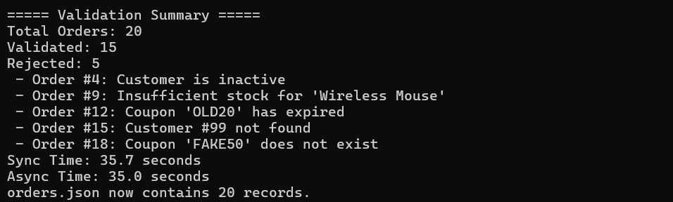

### Phase 2 — Concurrent Processing

#### Pricing and Order Processing

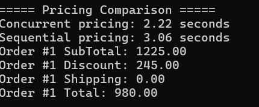

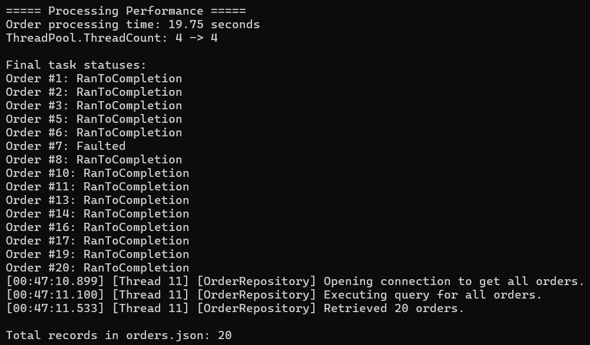

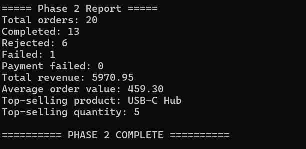

#### Race Condition and Faulted Tasks

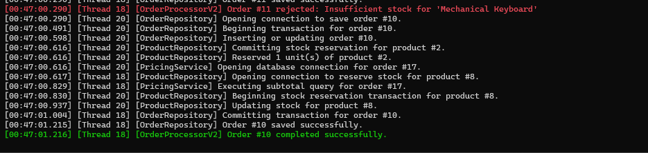


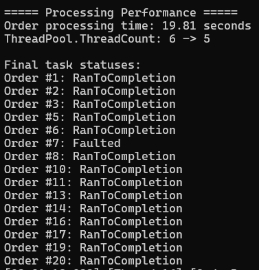

### Phase 3 — Full Checkout Workflow

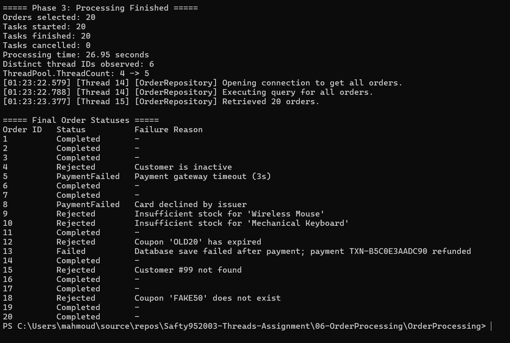

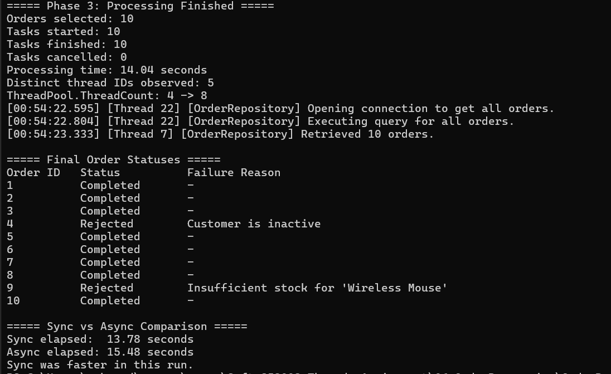

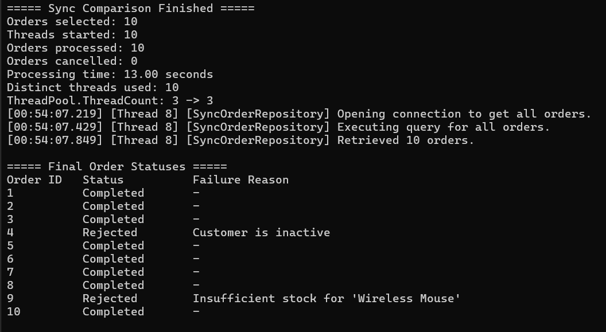

### Fire-and-Forget Demonstration

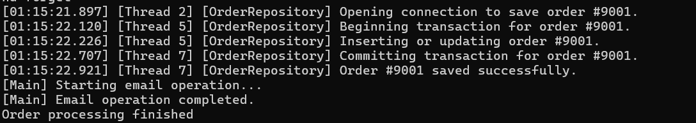

### Phase 4 — Advanced Async Workflows

#### Task 10.1 — Live Checkout

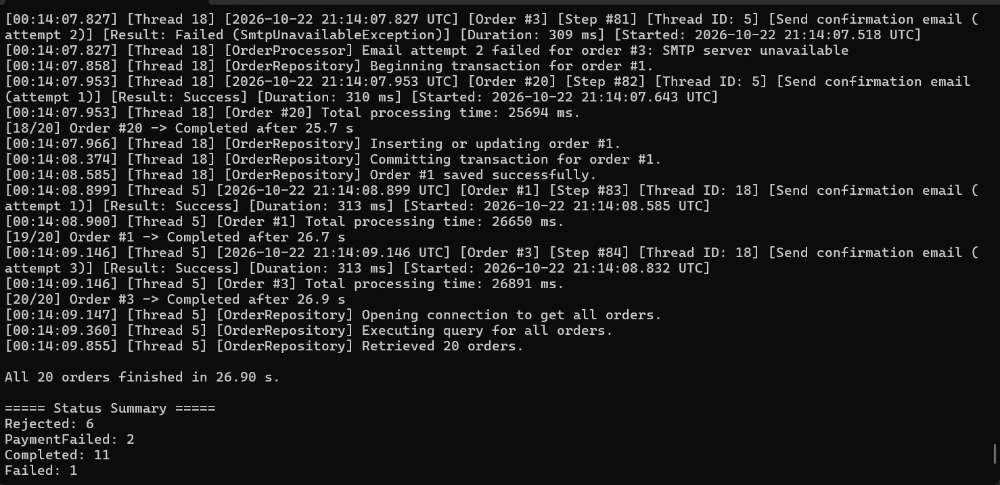

#### Task 10.2 — Dashboard

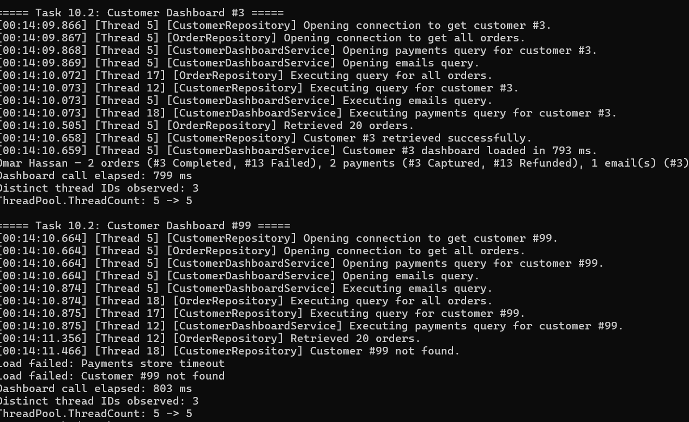

#### Task 10.3 — Shipping Quotes

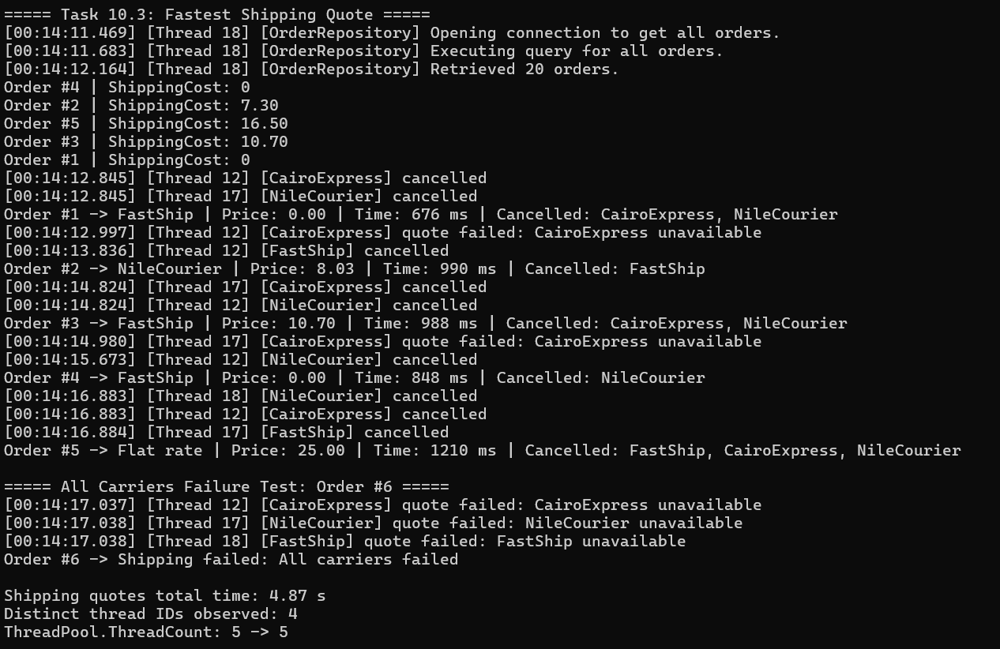

#### Task 10.4 A — Fraud Scoring

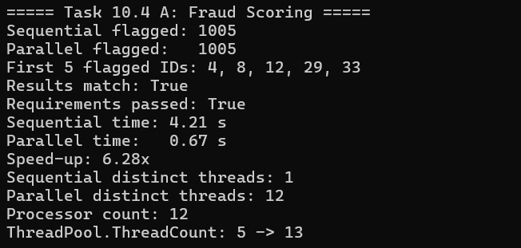

#### Task 10.4 B — Email Re-send

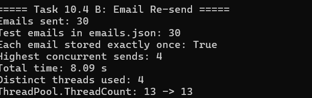

### Cancellation Test

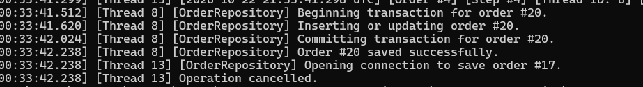

